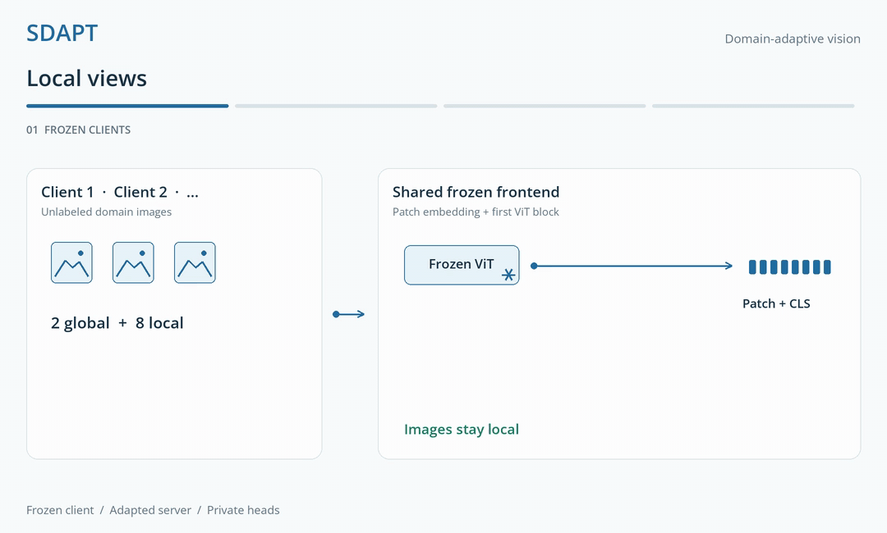

<h1 align="center">SDAPT</h1>
<p align="center"><strong>Domain Adaptive Pretraining in Split Learning<br>for Vision Foundation Models</strong></p>
<p align="center">Stan van Honk · <a href="https://vtsouval.github.io/"><strong>Vasileios Tsouvalas</strong></a> · Nirvana Meratnia</p>

## Abstract

**SDAPT** adapts vision foundation models to *distributed, unlabeled domain data*. Clients retain a **frozen image frontend** and send features to a shared server, where **self-distillation** learns from a combined batch of client representations. *LoRA adapters* and fully trained final blocks update the server model; an **exponential moving average teacher** supplies the training targets. The adapted backbone then stays *frozen* while each client trains a **private prediction head**. The workflow covers satellite imagery, chest radiographs, and sketches, with **FedAvg**, **MoCoSFL**, and **no-adaptation** comparisons.

<p align="center">
  <a href="docs/assets/readme/method-light.mp4" title="Watch the method video">
    <picture>
      <source media="(max-width: 600px) and (prefers-color-scheme: dark)" srcset="docs/assets/readme/method-dark-mobile.gif">
      <source media="(max-width: 600px)" srcset="docs/assets/readme/method-light-mobile.gif">
      <source media="(prefers-color-scheme: dark)" srcset="docs/assets/readme/method-dark.gif">
      
    </picture>
  </a>
</p>

## Setup

Create and activate the `sdapt` environment:

```bash
git clone https://github.com/Nousphera/SDAPT.git
cd SDAPT
python3.12 -m venv --prompt sdapt .venv
source .venv/bin/activate
```

From the activated `sdapt` environment, install the requirements:

```bash
python -m pip install -r requirements.txt
```

## Data and Weights

Prepare one dataset, or omit `--dataset` to prepare all three:

```bash
python scripts/prepare_data.py --dataset quickdraw
```

| Dataset | Source / Local Input |
|---|---|
| **QuickDraw** | [DomainNet](http://ai.bu.edu/M3SDA/) · automatic download |
| **fMoW** | [WILDS](https://wilds.stanford.edu/datasets/) · download or import with `--fmow-dir /path/to/fmow_v1.1` |
| **CheXpert** | [Training images](https://stanfordmlgroup.github.io/competitions/chexpert/) → `data/chexpert/raw/CheXpert-v1.0-small/` |
| **CheXlocalize** | [Test images](https://github.com/rajpurkarlab/cheXlocalize/blob/master/download_instructions.md) → `data/chexpert/raw/CheXlocalize/CheXpert/` |

CheXpert needs `train.csv` and `train/`; CheXlocalize needs `test_labels.csv` and `test/`. Obtain access from their publishers, extract the folders above, then run preparation with `--dataset chexpert`.

### Prepare Model

Download and verify your chosen pretrained encoder:

```bash
# Original SDAPT backbone
python scripts/prepare_model.py --model dinov2-vitb14

# DINOv3 Large
python scripts/prepare_model.py --model dinov3-vitl16
```

**DINO:** Small / Base, patch 8 or 16. **DINOv2:** Small / Base / Large / Giant, with or without register tokens. **DINOv3:** Small / Small+ / Base / Large / Huge+ / 7B, plus Large and 7B satellite weights. Use `--list-models` for exact names.

## Run Experiments

From the repository root, set the shared options and run your chosen method:

```bash
common=(--dataset quickdraw --model dinov2-vitb14
        --nr_of_clients 10 --batch_size 15 --nr_of_epochs 100
        --steps_per_epoch 250 --accumulation_steps 7
        --shots 4 8 16 0 --head_epochs 25 --random_seed 2024 --device cuda)

# SDAPT (Ours)
python scripts/run_experiment.py "${common[@]}" --method sdapt

# Federated DINO adaptation
python scripts/run_experiment.py "${common[@]}" --method fedavg --local_steps 50

# Split MoCo-v3 adaptation
python scripts/run_experiment.py "${common[@]}" --method mocosfl

# Frozen pretrained encoder, without adaptation
python scripts/run_experiment.py "${common[@]}" --method no-dapt
```

> [!NOTE]
> `0` selects full-data linear probing. Shot budgets are capped by each client's available labels; saved metrics include the actual counts. All methods reuse the same IID partitions. The run simulates clients and server on one machine.

For DINOv3, choose `--model dinov3-vitl16`, `dinov3-vith16plus`, or `dinov3-vit7b16`. Use `--parameter_dtype bfloat16 --gradient_checkpointing` to reduce frozen-weight and activation memory. Trainable weights and EMA teachers stay in FP32; full-model baselines need more memory. These are additional backbones; the original experiments use **DINOv2 ViT-B/14**.

Metrics, private heads, and adapted teacher weights are saved under `results/`. To evaluate a saved teacher:

```bash
python scripts/run_experiment.py --dataset quickdraw --model dinov2-vitb14 \
  --method sdapt --stage evaluate \
  --checkpoint results/sdapt-dinov2-vitb14-quickdraw-seed2024/teacher.pt \
  --nr_of_clients 10 --shots 4 8 16 0 --device cuda
```

[Code License](LICENSE) · [DINO](https://github.com/facebookresearch/dino) · [DINOv2](https://github.com/facebookresearch/dinov2) · [DINOv3](https://github.com/facebookresearch/dinov3)
